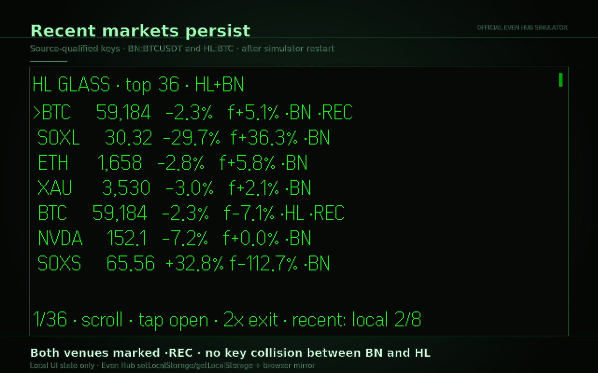

# HL Glass — a cross-exchange perp HUD for Even G2

Live perp market data on a 576×288 monochrome display: one board that merges
**Hyperliquid** and **Binance USDⓈ-M futures**, with mark/index, 24h change,
funding APR, open interest and a 24h sparkline. Read-only for trading — no keys,
no orders. The only write is a small local list of recently viewed markets.

Built for the **Even Realities G2** hackathon, **Crypto & DeFi** and
**Exchanges & Stocks** tracks. Binance's USDⓈ-M list also carries tokenized
equity and commodity perps (NVDA, SOXL, XAU), so the same HUD covers crypto and
stock-index exposure without a second app.

## Demo




Screenshots are 1280×800 compositions of the 576×288 framebuffer captured in
the official Even Hub simulator. The board shot shows both `·HL` and `·BN`
rows; the detail shot is Binance BTCUSDT; the recent shot was taken after a
simulator restart and shows source-qualified `·REC` markers on both venues.

[42-second demo video](https://matrixneoaiagent.github.io/hl-glass/hl_demo.mp4) · Browser preview: https://matrixneoaiagent.github.io/hl-glass/
- The browser preview renders the same 576×288 HUD; the Even Hub simulator or
  the G2 glasses show it through the Even App bridge.

## Why

Funding and open interest are the fastest read on perp positioning. A glanceable
HUD lets a trader check the top markets without pulling out a phone — and keeps
the interaction to the temple touchpad: scroll, tap, double-tap. One board
across two venues makes the same screen useful for crypto basis and for the
stock-index perps that now trade on Binance USDⓈ-M.

## Features

- **Cross-exchange board**: the top 24 Hyperliquid markets plus the top 12
  Binance USDT-M perps by 24h quote volume, merged and sorted by 24h volume.
  Seven rows at a time, every row tagged `·HL` or `·BN`.
- **Source-aware detail**: venue label, mark plus oracle (Hyperliquid) or index
  price (Binance), 24h change, 24h volume, OI in USD, funding APR, max leverage,
  24h range and a sparkline from that venue's hourly closes.
- **Normalised funding**: Hyperliquid hourly funding × 24 × 365; Binance
  8-hourly funding × 3 × 365. The per-interval rate is shown next to the APR.
- **Binance OI**: `openInterest × markPrice`, fetched for the top 12 BN symbols
  in parallel. An individual OI miss shows `—` instead of dropping the row.
- **Recent markets (local write)**: opening a detail persists a source-qualified
  key (`BN:BTCUSDT`, `HL:BTC`) through the Even Hub SDK (`setLocalStorage` /
  `getLocalStorage`, capped at 8). The list marks those rows `·REC` and the
  footer shows `recent: local n/8`. The value is local UI state only; it cannot
  place orders.
- **Controls**: scroll moves the selection, tap opens the detail, scroll in the
  detail moves to the next/previous market, tap goes back, double-tap exits.
- **Live and honest about failures**: refresh every 60 s. If Binance is
  unreachable the header says `BN down`, the Hyperliquid rows stay, and the next
  refresh retries. If Hyperliquid is unreachable the Binance rows stay. If both
  fail the app shows an offline state with tap-to-retry.
- **Browser fallback**: without the Even bridge the same view renders in the
  browser so judges and reviewers can see the UI without the simulator.

## Stack

- Vite + TypeScript, no framework.
- `@evenrealities/even_hub_sdk` text containers, the Even App bridge and its
  local storage API.
- Hyperliquid public API: `POST https://api.hyperliquid.xyz/info` with
  `metaAndAssetCtxs` and `candleSnapshot` (24×1 h candles).
- Binance USDⓈ-M public API (`https://fapi.binance.com`, CORS `*`):
  - `GET /fapi/v1/ticker/24hr` — `lastPrice`, `openPrice`,
    `priceChangePercent`, `quoteVolume`, `highPrice`, `lowPrice`.
  - `GET /fapi/v1/premiumIndex` — `markPrice`, `indexPrice`,
    `lastFundingRate`, `nextFundingTime`.
  - `GET /fapi/v1/openInterest?symbol=…` — base-unit OI, multiplied by mark.
  - `GET /fapi/v1/klines?symbol=…&interval=1h&limit=24` — close (index 4) for
    the selected detail only.
- No API keys, no account, no wallet.

## Local write path

`src/recent.ts` keeps up to eight source-qualified market keys, most recent
first. It is the only persisted state in the app. The storage key is
`hlglass.recent.v2`; entries are `BN:BTCUSDT` or `HL:BTC` so the same coin can
be recent on both venues without colliding.

- On opening a market detail (and when scrolling to another market in the
  detail view): `bridge.setLocalStorage('hlglass.recent.v2',
  JSON.stringify(list))`.
- On startup: `bridge.getLocalStorage('hlglass.recent.v2')`; after each write
  the value is read back through the same API and logged, so the test can
  verify it.
- The same list is mirrored to `window.localStorage` as a fallback. In the
  official simulator the host store is session-scoped: `setLocalStorage`
  returns `true` and an immediate `getLocalStorage` read-back matches, but the
  host store resets when the simulator process exits. The mirror is what keeps
  the marker alive across simulator restarts. On the glasses the SDK store is
  the primary path; the mirror is written as a fallback and is only read when
  the host store is empty or unavailable.
- No keys, no wallet, no orders. This write is local UI state and cannot trade.

## Run locally

```bash
npm install
npm run dev            # http://localhost:5173
npx evenhub-simulator http://localhost:5173
```

The app runs in the Even Hub simulator or on the glasses through the Even App.
Without the bridge it falls back to the browser preview. Binance and
Hyperliquid are called directly from the webview; both allow cross-origin
requests.

## Build

```bash
npm run build          # tsc --noEmit && vite build
npm run pack           # build + evenhub pack app.json dist
```

## Layout

```
576 × 288 monochrome
┌──────────────────────────────────────────────────────────┐
│ HL GLASS · top 36 · HL+BN                                │  header 30 px
│ >BTC   59,100  -2.5%  f+4.7% ·BN ·REC                    │
│  SOXL   30.20 -30.0%  f+35.5% ·BN                        │
│  ETH    1,657  -2.9%  f+5.8% ·BN                         │  body 222 px
│  XAU    3,534  -2.8%  f+2.0% ·BN                         │
│  BTC   59,096  -2.5%  f-7.6% ·HL                         │
│  …                                                        │
│ 1/36 · scroll · tap open · 2x exit · recent: local 2/8   │  footer 36 px
└──────────────────────────────────────────────────────────┘
```

## What existed before the hackathon

The repository was created on 2026-11-24 for the Even Realities G2 hackathon
with a Hyperliquid-only board. The Binance USDⓈ-M source, the merged board and
the source-qualified recent keys were added on 2026-11-25. The Even Hub
SDK/templates and the public exchange APIs are external dependencies; no app
code predates the event. The demo video was recorded in the official Even Hub
simulator.

## Data and honesty

- Prices, funding, open interest and candles come from the public Hyperliquid
  and Binance APIs; the app is read-only for trading and cannot place orders.
  The only write is the local recent list described above. No rows are
  fabricated: if a venue fails, its rows are removed and the header says so.
- Binance `openInterest` is base units, so OI USD is `openInterest × markPrice`.
- Funding is annualised per venue: Hyperliquid `funding × 24 × 365`, Binance
  `lastFundingRate × 3 × 365`. The 8-hourly/hourly rate is shown in the detail.
- Binance's ticker/premium endpoints do not publish per-market max leverage, so
  the detail shows `max —`; Hyperliquid shows its universe max leverage.
- If Binance is geo-blocked at runtime the board keeps Hyperliquid and displays
  `BN down`. OKX/Bybit are the documented fallback venues if a permanent
  Binance replacement is needed; they are not mixed into the board silently.
- Not financial advice.

## License

MIT.
