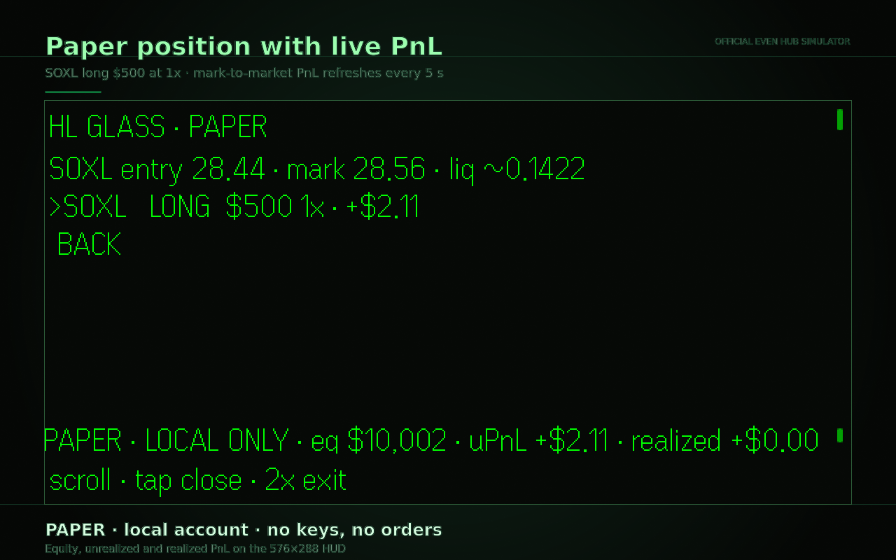
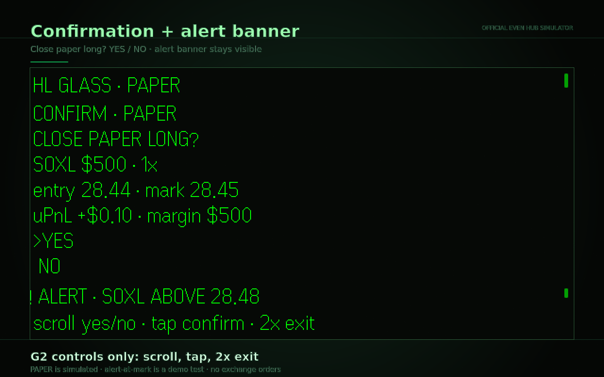

# HL Glass — a cross-exchange perp HUD + paper session for Even G2

Live perp market data on a 576×288 monochrome display: one board that merges
**Hyperliquid** and **Binance USDⓈ-M futures**, plus a **local paper-trading
session** with positions, live PnL, price alerts and quick Yes/No confirmations.
No keys, no real orders, no custody.

Built for the **Even Realities G2** hackathon, entered in both **Crypto & DeFi**
and **Exchanges & Stocks**. The Exchanges & Stocks track asks for a trading
session — PnL, positions, alerts and confirmations while open — so HL Glass adds
a paper account on top of the read-only board. The paper session is local to the
app; market data stays read-only.

## Demo





Screenshots are 1280×800 compositions of the 576×288 framebuffer captured in
the official Even Hub simulator. The board shot is the `STOCKS ·BN` filtered
board with the `PAPER` session row; the detail shot is Binance SOXL with
`STOCK PERP`; the paper shot shows an open long with live PnL; the confirmation
shot shows the Yes/No flow with a triggered alert banner. The merged `HL+BN`
board remains one scroll away and is shown in the demo video.

[2:40 demo video](https://matrixneoaiagent.github.io/hl-glass/hl_demo_full.mp4) · [44-second raw cut](https://matrixneoaiagent.github.io/hl-glass/hl_demo.mp4) · Browser preview: https://matrixneoaiagent.github.io/hl-glass/
- The browser preview renders the same 576×288 HUD; the Even Hub simulator or
  the G2 glasses show it through the Even App bridge.

## Why

Funding and open interest are the fastest read on perp positioning. A glanceable
HUD lets a trader check the top markets without pulling out a phone — and keeps
the interaction to the temple touchpad: scroll, tap, double-tap. One board
across two venues makes the same screen useful for crypto basis and for the
tokenized equity/commodity perps that now trade on Binance USDⓈ-M. The paper
session adds the part the Exchanges & Stocks track asks for: a position, its
live PnL, an alert and a quick confirmation, all on the glasses.

## Features

- **Cross-exchange board**: the top 24 Hyperliquid markets plus the top 12
  Binance USDT-M perps by 24h quote volume, merged and sorted by 24h volume.
  Every market row is tagged `·HL` or `·BN`.
- **Stocks mode**: a `STOCKS ·BN` control row opens a filtered list of every
  TRADING Binance tokenized equity/commodity perp classified from
  `exchangeInfo.underlyingType` (SOXL, NVDA, XAU, SOXS, SNDK, QQQ, …). The mode
  is data-driven, not a hardcoded three-symbol list. In the current live API it
  is 245 markets.
- **Source-aware detail**: venue label, mark plus oracle (Hyperliquid) or index
  price (Binance), 24h change, 24h volume, OI in USD, funding APR, max leverage,
  24h range and a sparkline from that venue's hourly closes. Tokenized
  equity/commodity rows say `STOCK PERP` / `COMMODITY PERP` instead of
  `Binance PERP`.
- **Paper account**: $10,000 paper, split as $9,500 spot + $500 margin. A
  `MOVE $500 SPOT -> MARGIN` action uses a Yes/No confirmation. The account,
  positions, alerts and realized PnL persist locally and can be reset.
- **Paper long/short**: open $100/$500/$1,000 notional at the current mark with
  1x/2x/3x leverage. Margin is locked per position; entry, size, leverage,
  approximate liquidation estimate and live unrealized PnL are shown.
- **Positions**: up to five open paper positions, each with live PnL, entry,
  mark and approximate liq. Tap a position to close it through Yes/No; closing
  returns margin + PnL and adds to realized PnL.
- **Price alerts**: set an above/below alert at +/-1%, +/-2% or +/-5% from the
  current mark. The paper ticker evaluates them every five seconds; a triggered
  alert shows a clear banner. Alerts can be listed and cancelled. `TEST @ MARK`
  is an explicit demo action that arms an alert at the current mark so the
  banner can be exercised without waiting for a move.
- **Quick confirmations**: moving spot to margin, opening, closing, resetting
  and cancelling an alert all use the same `>YES / NO` screen. Scroll chooses,
  tap confirms, double-tap exits.
- **Live and honest about failures**: board data refreshes every 60 s; paper
  marks refresh every 5 s. If Binance is unreachable the header says `BN down`,
  the Hyperliquid board stays, and paper trading still works on HL rows. If
  Hyperliquid is unreachable the Binance rows stay. If both fail the app shows
  an offline state with tap-to-retry.
- **Recent markets (local write)**: opening a detail persists a source-qualified
  key (`BN:BTCUSDT`, `HL:BTC`) and marks it `·REC`. Recent keys and paper state
  are separate local stores.
- **Browser fallback**: without the Even bridge the same view renders in the
  browser so judges and reviewers can see the UI without the simulator.

## Controls (G2 only)

No keyboard is required. Scroll = temple touchpad up/down, tap = click,
double-tap = exit.

**Board**
- Scroll up from the first market to `PAPER`, then to `STOCKS`; scroll down to
  return to the markets.
- Tap `STOCKS ·BN` to switch between the merged `HL+BN` board and the
  `STOCKS ·BN` filtered board; tap the `ALL · HL+BN` row to return.
- Tap `PAPER` to open the paper account.
- Tap a market to open its detail. `2x` exits.

**Market detail**
- Scroll moves to the next/previous market.
- Tap opens the paper action menu: `PAPER LONG`, `PAPER SHORT`, `PRICE ALERT`,
  `PAPER ACCOUNT`, `BACK TO MARKET`, `BACK TO LIST`.

**Paper ticket**
- Tap `NOTIONAL` to cycle `$100 -> $500 -> $1,000`.
- Tap `LEVERAGE` to cycle `1x -> 2x -> 3x`.
- Select `CONFIRM OPEN`, then scroll to `YES`/`NO` and tap.
- `CANCEL` returns to the action menu.

**Paper account**
- `POSITIONS` opens the live position list; tap a position to close it.
- `ALERTS` opens the alert list; tap an alert to cancel it.
- `MOVE $500 SPOT -> MARGIN`, `RESET PAPER` and `BACK` are the remaining rows.
- In every confirmation, scroll selects `YES`/`NO` and tap confirms.

**Alerts**
- In the alert screen, `ABOVE +X%` and `BELOW -X%` create an alert at the
  current mark, `STEP` cycles +/-1/2/5%, `TEST @ MARK` triggers the demo banner,
  `ALERTS` lists them, and `BACK` returns to the action menu.

## Stack

- Vite + TypeScript, no framework.
- `@evenrealities/even_hub_sdk` text containers (header, body, PAPER banner,
  footer), the Even App bridge and its local storage API.
- Hyperliquid public API: `POST https://api.hyperliquid.xyz/info` with
  `metaAndAssetCtxs` (marks, oracle, funding, OI), `candleSnapshot` (24×1 h
  closes) and `metaAndAssetCtxs` again for the 5-second paper marks.
- Binance USDⓈ-M public API (`https://fapi.binance.com`, CORS `*`):
  - `GET /fapi/v1/ticker/24hr` — `lastPrice`, `openPrice`,
    `priceChangePercent`, `quoteVolume`, `highPrice`, `lowPrice`.
  - `GET /fapi/v1/premiumIndex` — `markPrice`, `indexPrice`,
    `lastFundingRate`, `nextFundingTime`; `?symbol=…` is also used by the
    paper ticker.
  - `GET /fapi/v1/exchangeInfo` — `underlyingType` for Stocks mode
    (`EQUITY`/`HK_EQUITY`/`KR_EQUITY`/`CN_EQUITY`/`PREMARKET` => stock,
    `COMMODITY` => commodity). Cached for six hours.
  - `GET /fapi/v1/openInterest?symbol=…` — base-unit OI, multiplied by mark.
  - `GET /fapi/v1/klines?symbol=…&interval=1h&limit=24` — close (index 4) for
    the selected detail only.
- No API keys, no account, no wallet, no order endpoint, no custody.

## Paper state model

`src/paper.ts` is a local store; it makes no trading network call.

```ts
PaperState {
  spot: number                 // starts at 9,500
  margin: number               // free margin, starts at 500
  realized: number             // cumulative realized PnL
  positions: PaperPosition[]   // max 5
  alerts: PaperAlert[]         // max 5
}

PaperPosition {
  key, coin, symbol, venue, assetClass,
  side: 'long' | 'short',
  notional, leverage, entry, margin, lastMark, openedAt
}

PaperAlert {
  key, coin, venue,
  direction: 'above' | 'below',
  pct, target, createdAt
}
```

- Equity = `spot + free margin + locked position margin + unrealized PnL`.
- PnL = `(mark - entry) / entry × notional × direction`.
- Required margin = `notional / leverage`; it is deducted from free margin when
  the paper position opens and returned with PnL when it closes.
- Realized PnL accumulates on close; the banner and paper account show it.
- The approximate liquidation estimate is
  `entry × (1 - 1/leverage + 0.5%)` for a long and
  `entry × (1 + 1/leverage - 0.5%)` for a short. It is a simple paper buffer,
  not an exchange risk engine.
- Paper marks refresh every 5 s: Binance `premiumIndex.markPrice`, Hyperliquid
  `metaAndAssetCtxs.markPx`. If Binance is down, BN paper positions keep their
  last observed mark and HL positions continue to update. If the market is
  missing, the position stays closeable at its last mark.

Persistence: `hlglass.paper.v1` through
`bridge.setLocalStorage` / `bridge.getLocalStorage`, mirrored to
`window.localStorage`. The repo's simulator host store is session-scoped, so the
browser mirror is what survives a simulator restart; on the glasses the SDK
store is primary. Reset restores spot 9,500, free margin 500, realized 0 and
clears positions and alerts.

## Local writes

- `src/recent.ts` — `hlglass.recent.v2`, up to eight source-qualified market
  keys. Opening a detail writes the list and marks `·REC`.
- `src/paper.ts` — `hlglass.paper.v1`, the paper account, positions, alerts and
  realized PnL.

Both use the SDK store and a browser mirror. Neither can place an order. There
is no wallet, no private key, no API key and no custody anywhere in the app.

## Run locally

```bash
npm install
npm run dev            # http://localhost:5173
npx evenhub-simulator http://localhost:5173
```

The app runs in the Even Hub simulator or on the glasses through the Even App.
Without the bridge it falls back to the browser preview. Binance and
Hyperliquid are called directly from the webview; both allow cross-origin
requests. The browser preview also accepts arrow keys and Enter for convenience,
but the G2 scroll/tap/2x path is the supported control scheme.

## Build

```bash
npm run build          # tsc --noEmit && vite build
npm run pack           # build + evenhub pack app.json dist
```

## Layout

```
576 × 288 monochrome
┌──────────────────────────────────────────────────────────┐
│ HL GLASS · top 36 · HL+BN                                │  header 30 px
│  STOCKS ·BN 245 · SOXL -31.9% · tap                      │
│  PAPER · eq $10,000 · flat                               │
│ >BTC   59,038  -2.2%  f+9.0% ·BN ·REC                    │
│  SOXL   28.98 -31.9%  f+39.7% ·BN ·REC                   │  body 198 px
│  ETH    1,655  -2.4%  f+5.0% ·BN                         │
│  XAU    3,528  -2.7%  f+4.5% ·BN                         │
│  BTC   59,037  -2.2%  f+2.7% ·HL ·REC                    │
├──────────────────────────────────────────────────────────┤
│ PAPER · LOCAL ONLY · eq $10,000 · uPnL +$0.00 · …        │  banner 24 px
├──────────────────────────────────────────────────────────┤
│ 1/36 · scroll · tap open · 2x exit · recent: local 2/8   │  footer 36 px
└──────────────────────────────────────────────────────────┘
```

## What existed before the hackathon

The repository was created on 2026-11-24 for the Even Realities G2 hackathon
with a Hyperliquid-only board. The Binance USDⓈ-M source, the merged board and
source-qualified recent keys were added on 2026-11-25, followed by Stocks mode
and the local paper session. The Even Hub SDK/templates and the public exchange
APIs are external dependencies; no app code predates the event. The demo video
was recorded in the official Even Hub simulator.

## Data and honesty

- Prices, funding, open interest and candles come from the public Hyperliquid
  and Binance APIs. The app is read-only for trading and cannot place orders.
  The only writes are local recent keys and the local paper session.
- **PAPER is simulated.** It never sends an order, never asks for a key or
  signature, and never touches a real account. Fills use the current mark with
  no slippage, fees or funding; the liquidation estimate is approximate. It is
  a UI/risk-flow demo, not financial advice.
- Binance `openInterest` is base units, so OI USD is `openInterest × markPrice`.
- Funding is annualised per venue: Hyperliquid `funding × 24 × 365`, Binance
  `lastFundingRate × 3 × 365`. The 8-hourly/hourly rate is shown in the detail.
- Binance's ticker/premium endpoints do not publish per-market max leverage, so
  the detail shows `max —`; Hyperliquid shows its universe max leverage.
- If Binance is geo-blocked at runtime the board keeps Hyperliquid and displays
  `BN down`; Stocks mode shows `STOCKS ·BN down`, and paper trading continues on
  HL rows. OKX/Bybit are the documented fallback venues if a permanent Binance
  replacement is needed; they are not mixed into the board silently.
- A triggered alert is a local paper notification, not an exchange alert. The
  `TEST @ MARK` row deliberately arms an alert at the current mark to exercise
  the banner in a demo; normal alerts wait for the real mark to cross.
- No rows or prices are fabricated: if a venue fails, its rows are removed and
  the header says so.

## License

MIT.
