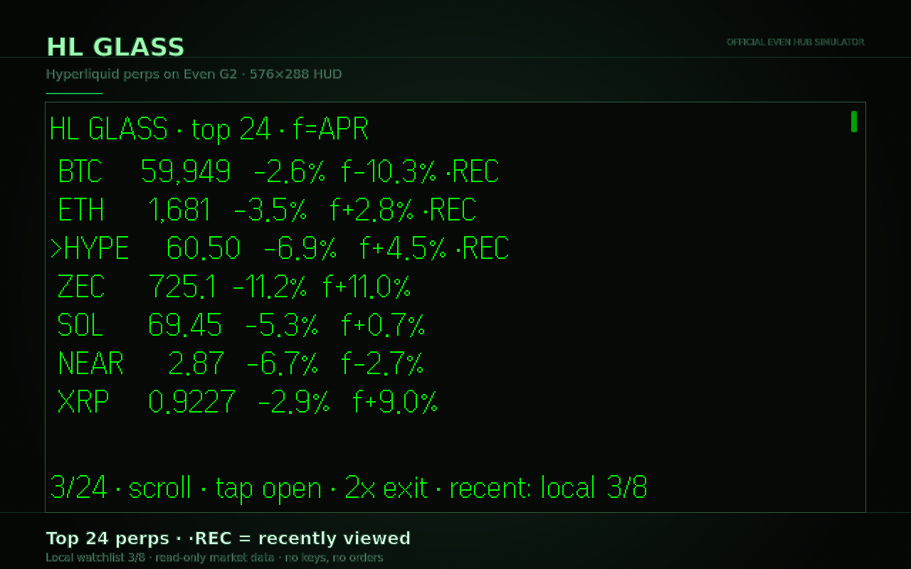
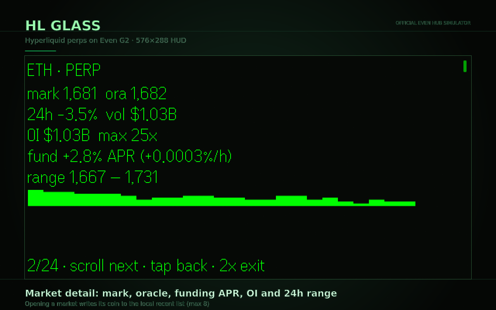

# HL Glass — a Hyperliquid HUD for Even G2

Live perp market data on a 576×288 monochrome display: mark/oracle, 24h change,
funding APR, open interest and a 24h range sparkline for the top Hyperliquid
markets. Read-only for trading — no keys, no orders. The only write is a small
local list of recently viewed markets.

Built for the **Even Realities G2** hackathon, **Crypto & DeFi** track (Hyperliquid).

## Demo





Screenshots are 1280×800 compositions of the 576×288 framebuffer captured in
the official Even Hub simulator.

[43-second demo video](https://matrixneoaiagent.github.io/hl-glass/hl_demo.mp4) · Browser preview: https://matrixneoaiagent.github.io/hl-glass/
- The browser preview renders the same 576×288 HUD; the Even Hub simulator or
  the G2 glasses show it through the Even App bridge.

## Why

Funding and open interest are the fastest read on perp positioning. A glanceable
HUD lets a trader check the top markets without pulling out a phone — and keeps
the interaction to the temple touchpad: scroll, tap, double-tap.

## Features

- **Top 24 perps by 24h volume**, one screen, seven rows at a time.
- **Market detail**: mark, oracle, 24h change, 24h volume, OI in USD, max
  leverage, funding APR (and the hourly rate), 24h low/high, sparkline.
- **Recent markets (local write)**: opening a detail persists the coin name
  through the Even Hub SDK (`setLocalStorage` / `getLocalStorage`, capped at 8).
  The list marks those rows `·REC` and the footer shows `recent: local n/8`.
  The value is local UI state only; it cannot place orders.
- **Controls**: scroll moves the selection, tap opens the detail, scroll in the
  detail moves to the next/previous market, tap goes back, double-tap exits.
- **Live**: refresh every 60 s; offline state keeps the last data and offers a
  tap-to-retry.
- **Browser fallback**: without the Even bridge the same view renders in the
  browser so judges and reviewers can see the UI without the simulator.

## Stack

- Vite + TypeScript, no framework.
- `@evenrealities/even_hub_sdk` text containers, the Even App bridge and its
  local storage API.
- Hyperliquid public API: `POST https://api.hyperliquid.xyz/info` with
  `metaAndAssetCtxs` and `candleSnapshot` (24×1 h candles).

## Local write path

`src/recent.ts` keeps up to eight coin names, most recent first. It is the only
persisted state in the app.

- On opening a market detail (and when scrolling to another market in the
  detail view): `bridge.setLocalStorage('hlglass.recent.v1',
  JSON.stringify(list))`.
- On startup: `bridge.getLocalStorage('hlglass.recent.v1')`; after each write
  the value is read back through the same API and logged, so the test can
  verify it.
- The same list is mirrored to `window.localStorage` as a fallback. In the
  official simulator the host store is session-scoped: `setLocalStorage`
  returns `true` and an immediate `getLocalStorage` read-back matches, but the
  host store resets when the simulator process exits. The mirror is what keeps
  the marker alive across simulator restarts. On the glasses the SDK store is
  the primary path; the mirror is written as a fallback and is only read when
  the host store is empty or unavailable.
- No keys, no wallet, no orders. This write is local UI state and cannot trade.

## Run locally

```bash
npm install
npm run dev            # http://localhost:5173
npx evenhub-simulator http://localhost:5173
```

The app runs in the Even Hub simulator or on the glasses through the Even App.
Without the bridge it falls back to the browser preview.

## Build

```bash
npm run build          # tsc --noEmit && vite build
npm run pack           # build + evenhub pack app.json dist
```

## Layout

```
576 × 288 monochrome
┌──────────────────────────────────────────────────────────┐
│ HL GLASS · top 24 · f=APR                                │  header 30 px
│ >BTC   59,737  -3.2%  f-3.1% ·REC                        │
│  ETH    1,675  -4.6%  f+6.7% ·REC                        │  body 222 px
│  …                                                        │
│ 1/24 · scroll · tap open · 2x exit · recent: local 3/8   │  footer 36 px
└──────────────────────────────────────────────────────────┘
```

## What existed before the hackathon

Nothing in this repository: it was created on 2026-11-24 for the Even Realities
G2 hackathon. The Even Hub SDK/templates and the Hyperliquid public API are
external dependencies; no app code predates the event. The demo video was
recorded in the official Even Hub simulator.

## Data and honesty

- Prices, funding and OI come from Hyperliquid's public API; the app is
  read-only for trading and cannot place orders. The only write is the local
  recent list described above.
- Not financial advice. Funding is shown annualised as `funding × 24 × 365`;
  the hourly rate is shown in the detail line.
- No API keys, no wallet, no account.

## License

MIT.
